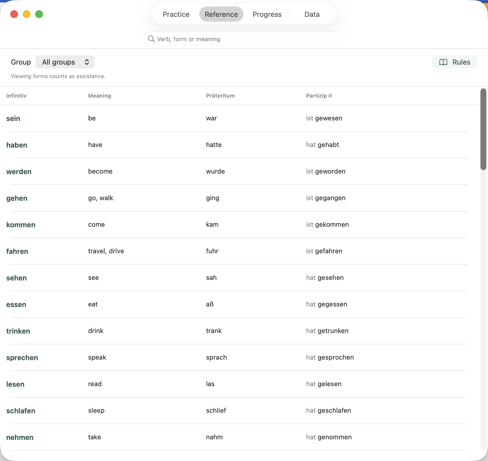

# Deutsche Verben

[](https://github.com/Wreos/DeutscheVerben/actions/workflows/ci.yml)

An offline German verb trainer for iPhone and Mac, built with SwiftUI and a local Swift package. The interface, verb meanings and context notes follow the system language, with English, German and Russian support. Other languages fall back to English. German forms and examples remain in German.

## Features

- 60 German verbs in A1, A2 and B1 study groups, with Präteritum and a combined auxiliary + Partizip II field. Enter forms such as `hat gemacht` or `ist gegangen`. Infinitive auxiliaries (`haben` / `sein`) are also accepted.
- Sessions of up to 10 verbs, saved drafts and session recovery after restarting the app.
- Spaced repetition, original-answer history and assistance tracking.
- A searchable verb table with examples and usage rules.
- JSON import, export and restore with backups.
- Light and dark appearance, system text sizes and Mac keyboard shortcuts.

## Screenshot

The Mac reference table in English. Captured from the running app using isolated test data.



## Getting started

You need a Mac with Xcode and Swift 6. The app supports iOS 18 and macOS 15 or later.

Open `DeutscheVerben.xcodeproj`, select the `DeutscheVerben` scheme and choose My Mac or an iPhone Simulator, then run the app. To install it on your own iPhone, select your Apple Development Team in Signing & Capabilities.

You can also build and open the Mac app using the included script.

```sh
./scripts/build.sh macOS
open Build/macOS/Products/Debug/DeutscheVerben.app
```

The script uses local ad-hoc signing. Distributing a compiled app requires appropriate signing and notarization, or an App Store release.

## Progress and data transfer

Each device stores progress in `Application Support/DeutscheVerben/progress.json`. The previous version is kept alongside it as `progress.json.previous`, and imports create an additional backup.

To transfer progress between iPhone and Mac, export JSON from the Data tab and import it on the other device. Cross-device transfer is manual. Imports merge history and stop with an error when two versions of the same session conflict. The separate Restore from JSON Backup action replaces the current state after backing it up.

The app supports v1 exports from the original web trainer. Viewing correct forms is recorded as assistance, and assisted attempts are excluded from independent scheduling progress. The scheduling policy is described in the [spaced repetition research notes](Documentation/RESEARCH.md).

## Development

- `App/` contains the SwiftUI interface and app state model.
- `Packages/VerbTrainerCore/` contains the dictionary, grading, scheduling, validation and storage.
- `UITests/` contains app scenarios using isolated temporary data.
- `scripts/` contains build, Xcode project generation and icon generation tools.
- `Documentation/` contains research notes, platform references and screenshots.

The Xcode project is included. The Ruby gem `xcodeproj` is needed only to regenerate it. The app has no third-party runtime dependencies.

GitHub Actions checks Swift formatting, script syntax, core tests, iOS and macOS release builds, and macOS UI scenarios. Formatting rules live in `.swift-format` and use the `swift-format` tool bundled with Xcode.

Test storage overrides and deterministic queues are available in Debug builds. Test fixtures contain synthetic answers.

## Limitations

The 60 verbs and their examples cover part of German grammar. Progress stages describe practice results and do not establish a CEFR level. Validation on a physical iPhone and user testing with VoiceOver are still pending.
